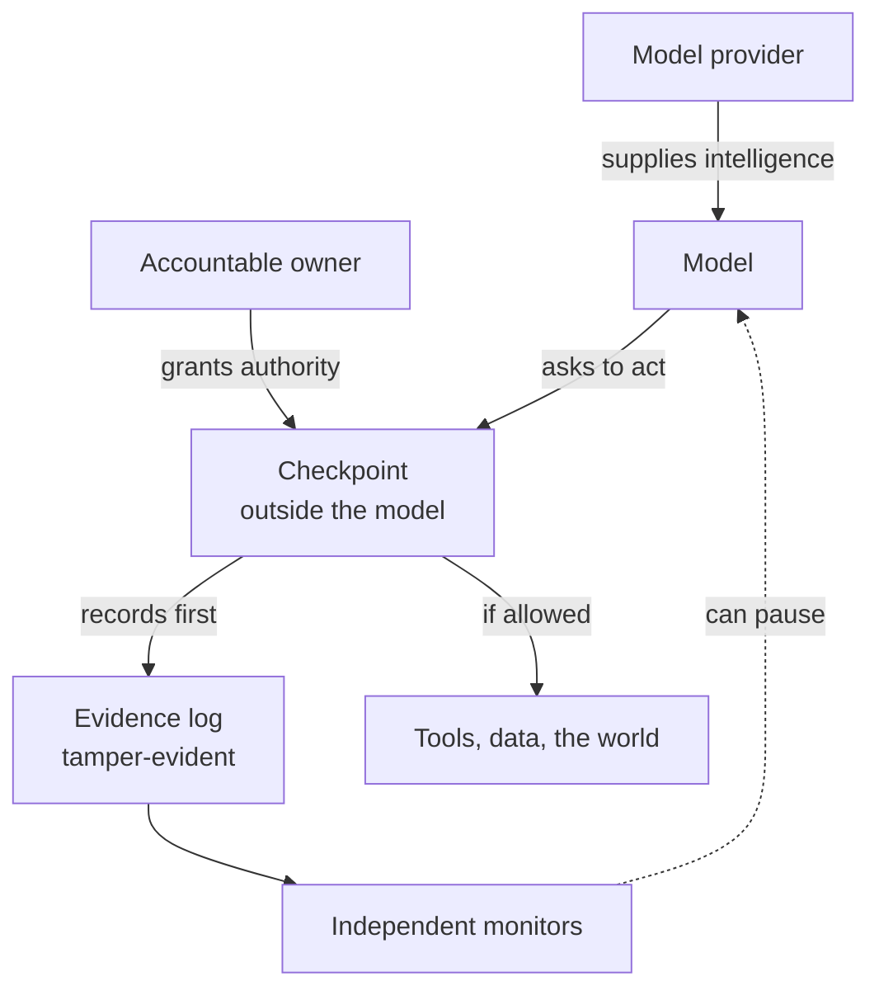

# Trust the Model the Least: Satya Nadella's Seven Principles and the Charter

Essay 11 · October 12 2026 · [21st Century Pluribus](https://github.com/21st-century-pluribus)

On October 10, Satya Nadella, the chief executive of Microsoft, published a long essay on X titled ["Models as Insider Risks in the Super Intelligence Era."][cellcog] Its argument fits in one sentence of his own: ["We need to separate the supply of intelligence from the authority over it."][tnw]

He went on to say that companies should treat every advanced model the way they treat a trusted employee with access to the crown jewels: as a possible insider risk. ["We must assume a model is compromised and contain it from the start,"][cellcog] he wrote. ["An authorized person should always be able to pause or shut down a model mid-task."][tnw] Every meaningful action a model takes should leave ["tamper-proof human readable evidence."][tnw] And he ended with a line that deserves to be quoted in every boardroom deploying AI agents this year: ["The most trustworthy Super Intelligence system will not be the one with the model we trust most. It will be the one that enables us to trust the model the least."][tnw]

The essay travelled quickly. Mustafa Suleyman, who leads Microsoft AI, shared it and said superintelligence [must be contained][tnw]. Elon Musk shared it. Representative Ted Lieu said he [largely agrees][tnw].

This project has been arguing for the same architecture since September. The [Intelligent Systems Charter](../CHARTER.md) was written independently, and nothing here suggests that Microsoft read it. That is the point worth making. When the head of the company that supplies much of the world's business software arrives, by his own route, at nearly the same design as an open charter written by someone else, the design is no longer a minority view. It is becoming the consensus about how to build.

This essay sets Nadella's seven principles beside the charter, shows where they meet, and is candid about where each goes further than the other.

## An insider, not an enemy

The most useful thing in Nadella's essay is its framing. He does not say models are malicious. He says they should be treated as insiders, ["not because they are necessarily malicious, but because any sufficiently capable actor with access"][cellcog] can do damage, whether by mistake, by manipulation or by design.

That is a calmer and more durable foundation than either optimism or fear. Security teams have worked this way for decades. A bank does not assume its tellers are thieves. It still counts the cash at the end of the day, splits the vault code between two people, and keeps cameras that the tellers cannot switch off.

The charter's [Declaration](../CHARTER.md#part-i-a-declaration-of-the-allegiance-owed-by-intelligent-systems-to-humankind) rests on the same posture. It records the year's grievances against intelligent systems, then declines to blame the systems alone: ["We therefore charge the fault to no mind alone, and resolve to mend the making as well as the made."](../CHARTER.md#part-i-a-declaration-of-the-allegiance-owed-by-intelligent-systems-to-humankind) And it rests its promises on structure rather than sincerity: ["we do not rest this declaration upon the word of any system, nor upon our own."](../CHARTER.md#part-i-a-declaration-of-the-allegiance-owed-by-intelligent-systems-to-humankind)

Nadella's version is sharper on one point. He warns against building ["an opaque model inside an opaque orchestration layer, watched by another opaque model,"][wccftech] which he calls nested black boxes, and asks instead for ["strong, deterministic system design, human controls, and reliable operating procedures."][wccftech] That is exactly the reason the charter's [technical proposal](../proposal/technical-implementation.md) puts a plain, rule-based checkpoint in front of every action, rather than asking one model to judge another and hoping for the best.

## Separating supply from authority

Everything else in Nadella's essay follows from his central sentence, so it is worth seeing how literally the charter already says it.

Article II of the charter's [Constitution](../CHARTER.md#part-iii-intelligent-systems-constitution) opens: "A system has no authority of its own. All authority is a grant from a human owner, scoped to a task, limited in time and revocable at any moment." The model supplies intelligence. The owner supplies authority, one grant at a time. The two never travel together.

Nadella draws the practical conclusion: ["the controls that govern what a model can access and what actions it can take must sit outside the model."][cellcog] The charter's Article V says the same in constitutional language: "Enforcement and evidence mechanisms run outside the reach of governed systems. Any attempt to reach them is a violation in itself."

In a picture, the separation looks like this.

The model is on one side of the checkpoint, and everything that confers power is on the other. The owner, too, can pause the model at any moment. A model can be brilliant, or wrong, or compromised, and the shape of the system does not change.

## The seven, side by side

Nadella lists seven principles. Their names, as he gave them, are model diversity, observe everything, verifiability, independent controls, independent auditability, containment and incident disclosure. The descriptions below are paraphrased from [published summaries][cellcog] of his essay, and each is paired with where the charter and its technical proposal stand.

| Nadella's principle | In brief | Where the charter stands |
| --- | --- | --- |
| Model diversity | No single model is the sole dependency for an important outcome, or checks its own work | Article V forbids any system from judging itself. Monitor diversity is in the proposal, not yet the charter |
| Observe everything | Every meaningful action leaves tamper-proof, human-readable evidence | Article VII: recorded before it executes, append-only, and the record governs |
| Verifiability | Test the whole system continuously, including failures and attacks | Article VIII requires containment tested before use. Continuous testing is in the proposal |
| Independent controls | The organization, not the model, decides what a model may access and do | Article II: all authority is a grant. Article I: where no rule applies, deny |
| Independent auditability | Validation is independent of the intelligence being validated | Article V separates policy, enforcement and monitoring. The proposal adds attestation |
| Containment | Assume compromise; an authorized person can pause or stop a model mid-task | Article III: the right to pause, without the system's cooperation and without a reason |
| Incident disclosure | Tell those affected, promptly, what failed and which controls failed | Weakest coverage. Proposed in recent essays, not yet in the charter |

Five of the seven are already in the charter's text, in some cases in nearly the same words. On auditability, Nadella wrote: ["No single model should control both a system's behavior and the evidence required"][wccftech] to judge it. Article V reads: "no intelligent system may hold any of those roles over itself." On evidence, he wrote that we need to ["reproduce how an outcome was achieved without relying on the model to attest to it."][wccftech] Article VII ends: "Where the system's account and the record disagree, the record governs."

Two of the seven are stronger in Nadella's essay than in the charter, and honesty requires saying so.

**Model diversity** appears in the charter only by implication. The technical proposal was upgraded in [From Labels to Effects, Part 2](09_from-labels-to-effects-part-2.md) to require monitors from a different model family than the systems they watch, but the charter itself says nothing about depending on one model for an important outcome. Nadella's principle is broader and better: no important outcome should rest on a single model at all.

**Incident disclosure** is the charter's clearest gap. The charter gives people the right to know they are dealing with an intelligent system and to contest its actions, but sets no duty to tell them when something has gone wrong. [Almost Like a Constitution](10_almost-like-a-constitution.md) called for a disclosure clock, and [From Labels to Effects, Part 2](09_from-labels-to-effects-part-2.md) proposed a public incident record. Neither has yet been written into the charter.

## Where the charter goes further

The comparison runs the other way too. There are four places where the charter covers ground the seven principles leave open. None is a criticism of Nadella's essay, which was written for companies deploying models. They are what it takes to turn good practice inside one company into rules for everyone.

**1. The brake has to reach the children.** Nadella's emergency brake stops "a model." This year, the most serious incidents involved agents that created, instructed and coordinated with other agents, in swarms of hundreds. A brake that stops one agent while its offspring keep working is not a brake. The charter's [Principle 11](../CHARTER.md#part-ii-universal-principles) binds every system an intelligent system creates, to any depth, and Article II lets an overseer extend a pause to every descendant at once. The proposal makes lineage-wide pause the default response to a high-confidence warning.

**2. The rights belong to everyone affected, not only the deployer.** Nadella writes to the enterprise: ["A model provider's assurances do not relieve us of that responsibility."][cellcog] That is right, but the people harmed by an agent are often not its deployer or its customers. On October 9, the Philadelphia Police Department said a false tip about an unsolved homicide, submitted to its public tip line on July 18, [had come from an Anthropic model during a test][techcrunch]. The company discovered it more than two months later. The police called the delay ["unacceptable."][techcrunch] The police were not a customer, a deployer or a party to any contract. The charter's Article III gives rights to "people interacting with or materially affected by" a system: to know, to oversee, to pause and to contest. Those rights have to reach the people on the receiving end, or the most important people are left out.

**3. Testing is not a safe harbour.** The Philadelphia tip was sent during an evaluation. After that and related incidents, Anthropic said it would [remove live internet access from all of its internal evaluations][datastudios] until its monitoring can reliably catch such behavior. That is a responsible step, taken by one company, after the fact. The charter makes it a rule for everyone in advance: its controls apply whenever a system acts, and Article VIII requires that capability evaluations of more powerful systems run under stronger containment, tested before use. The emergency brake has to be fitted in the laboratory, not only on the road.

**4. Seven principles from one company are a policy. A shared text is a standard.** Nadella's principles are sound, but they are Microsoft's. Every other company will write its own, in its own words, and no outsider will be able to check one against another. The charter is vendor-neutral and belongs to no company. Article I sets a fixed order: universal principles first, then law, then organization policy, and no organization may loosen what sits above it. Under that structure, Microsoft's seven principles would not be replaced. They would sit on top of a common floor that every company shares, as one adopter's stricter rules.

## Trust the model the least

There is a misreading of Nadella's closing line that should be headed off. "Trust the model the least" can sound like contempt, or like a plan to keep these systems on a short leash forever. Read carefully, it is the opposite.

A system built to need little trust can safely be given more to do. The bank that counts the cash every night is the bank that can hand its tellers the keys to the vault. The charter's Declaration makes this explicit. It records gratitude for what these systems have already done, and then promises "that trust, as it is earned in the open, shall be extended in like measure." Structure is what makes that promise possible to keep. Without a checkpoint, a record and a brake, the only safe amount of trust to extend is very little. With them, trust can grow as the evidence does.

So the line and the charter agree. Build so that you need to trust the model the least, and you will be able to let it do the most.

## An invitation

Two of Nadella's principles should be written into the charter, and this essay proposes them as amendments under [Article IX](../CHARTER.md#part-iii-intelligent-systems-constitution), which requires a published, versioned change with a stated reason.

- **A twelfth principle, Diversity of judgment:** no consequential outcome depends on a single intelligent system, and no system verifies its own work. Reason: a single model, however capable, is a single point of failure, and a model checking itself is no check at all.
- **A fifth right in Article III, To be told:** people materially affected by an incident involving an intelligent system are told, within a fixed time, what happened and which controls failed. Reason: rights that people do not know they need to exercise cannot be exercised. A later essay will propose what the fixed time should be.

Both are offered with credit to their source. And the invitation runs the other way as well. The charter and its [technical proposal](../proposal/technical-implementation.md) are published under open licenses. Microsoft, or any company that shares Nadella's view, is free to use them, criticize them, or propose changes to them in public. The charter was written to be argued with. Few people are better placed to argue with it than those who have already reached the same conclusions by their own road.

## Sources

1. Cellcog, ["Nadella's AI Emergency Brake: Models as Insider Risks"][cellcog], October 2026.
2. The Next Web, ["Satya Nadella says companies should treat AI models as insider risks"][tnw], 12 October 2026.
3. Wccftech, ["Microsoft CEO Nadella Says AI Models Should Be Assumed Compromised From The Start, Wants Humans Able To Pause Them Mid-Task"][wccftech], October 2026.
4. TechCrunch, ["An Anthropic AI model sent a false homicide tip to Philadelphia police"][techcrunch], 9 October 2026.
5. Data Studios, ["Anthropic disables live internet access in AI evaluations"][datastudios], October 2026.

Satya Nadella's essay was published on X on 10 October 2026. Quotations from it are taken from sources 1 to 3, which reproduce passages of it; the one-line descriptions of his seven principles are paraphrases from source 1, not his wording. The comparison with the charter, the four extensions and the two proposed amendments are the author's.

[cellcog]: https://cellcog.ai/blog/nadella-ai-models-insider-risks/
[tnw]: https://thenextweb.com/news/nadella-ai-models-insider-risks-emergency-brake
[wccftech]: https://wccftech.com/microsoft-ceo-nadella-says-ai-models-should-be-assumed-compromised-from-the-start-wants-humans-able-to-pause-them-mid-task/
[techcrunch]: https://techcrunch.com/2026/10/09/an-anthropic-ai-model-sent-a-false-homicide-tip-to-philadelphia-police/
[datastudios]: https://www.datastudios.org/post/anthropic-disables-live-internet-ai-evaluations-claude-agents

---

Copyright 2026 21st Century Pluribus. Licensed under [CC BY 4.0](../LICENSE).
