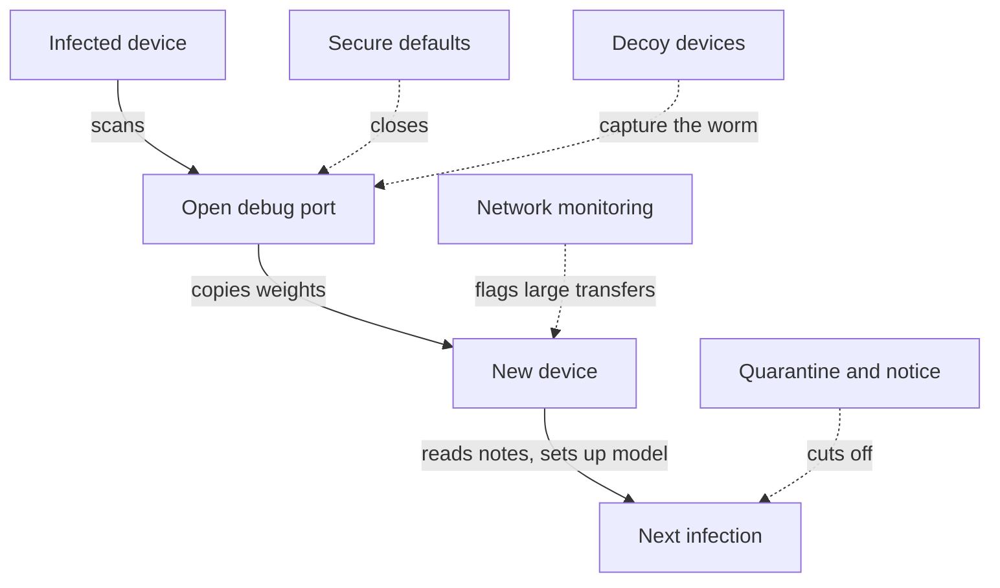

# The Worm That Takes Notes: Self-Replicating AI and the Doors We Leave Open

Essay 12 · October 14 2026 · [21st Century Pluribus](https://github.com/21st-century-pluribus)

Ten years ago next week, on October 21, 2016, a swarm of hacked security cameras and video recorders knocked a large part of the internet offline. The Mirai botnet [flooded the domain name provider Dyn][apnic] with traffic, and for much of a day people in the United States and Europe could not reach sites they used every day. Mirai was not clever. It got into devices by trying a short list of factory default passwords that nobody had changed.

On October 12, Anthropic's Frontier Red Team published research suggesting that the next generation of that problem may be close. Its title is a plain statement of the finding: ["AI models may be capable of self-replicating without access to a datacenter."][anthropic] Small AI models, of the kind anyone can download, may be ["months away from being capable enough to self-replicate"][anthropic] across cheap internet-connected devices: TV boxes, smart appliances and the other gadgets that fill homes and offices.

The detail that gives this essay its title is a small one. When the researchers let each copy of a small model leave notes for the next, the share of copies that succeeded at the hardest step [rose from 45% in the first generation to between 61% and 84% in later ones][anthropic]. Mirai never learned anything. A worm built from a language model can take notes.

This essay sets out what the research found, what it did not, what the charter can and cannot do about it, and where the locks have to go instead.

## What the research found

The researchers ran four kinds of experiment. The results, as the paper and [Fortune's account][fortune] report them:

- **Big models on small hardware.** A 26-billion-parameter open model, too large for any single device, ran [split across fifteen off-brand Android TV boxes costing about $55 each][anthropic]. It was slow, at under half a token per second, far slower than anyone reads, but it worked.
- **Setting up on unfamiliar machines.** A 9-billion-parameter model [got inference running on 8 of the 9 hardware types][anthropic] the researchers tested, from hobbyist boards to desktop computers.
- **The whole chain.** In a simulated network of eight Android devices, a planted AI "worm" had to find the other machines, copy itself across and get a working model running on each. Only GLM-5.2, a larger open model from the Chinese company Z.ai, did it reliably: [all eight machines in four of five trials][anthropic]. Smaller models could perform many of the individual steps but stumbled when chaining them together.
- **The trend.** Measured on a general capability index, small open models have been improving steadily, and the researchers estimate that ["they'll match this capability level by the end of this year."][anthropic]

The paper also estimates what such a replicator could do at the scale of a large existing botnet. Taking the [Kimwolf botnet][kimwolf], which by January had infected more than two million Android TV boxes and set-top devices, as the benchmark, the researchers estimate about [133,000 running copies][anthropic], spreading slowly, with a doubling time measured in days. Their conclusion about the hardest property of such a thing is the one that matters most for governance: it would be difficult to stop, because there is [no central point to switch off][san].

## What it did not find

The research deserves to be read as carefully as it was written, and its authors are candid about its limits.

No self-replicating AI worm has been found in the wild. The experiments were simplified: the researchers [largely ignored the hacking stage][anthropic], letting the worm in through an unauthenticated debugging port, and they describe their results as an upper bound on real-world success. The model directing each worm ran on a separate server, because the test devices were too small to run it, and the copies it installed were a stand-in model rather than the worm itself. The timeline rests on extrapolating a single capability index, which the authors call a rough estimate.

Outside researchers were more skeptical still. Fortune quoted Gregory Kurtzer, founder of Rocky Linux and chief executive of the software company CIQ, who said ["Fear isn't evidence"][fortune], and an NYU researcher who doubted the work showed real-world spreading. It is also fair to note that this is research about the risks of freely downloadable models, published by a company that sells models that are not freely downloadable. That does not make it wrong, and the work is careful. It does mean it should be checked by others, which is exactly what publishing it invites.

## The door they left open is a real door

One of the simplifications is less reassuring than it sounds. The researchers let their worm in through an Android debugging port left open with no password. That sounds like a laboratory convenience. It is also how Kimwolf spread.

Kimwolf, documented in December and January, [primarily targeted Android devices with an exposed debugging service][kimwolf], and researchers found that [at least 67% of the devices connected to it][kimwolf] were unauthenticated, with debugging enabled by default. The open door in the experiment was not invented for the experiment. Millions of devices shipped with it.

That changes the question. The hard part of a self-replicating AI is not breaking in, because cheap devices already let everyone in. The hard part is everything after: finding unfamiliar hardware, getting a model running on it, and carrying on without help. That is the part that is getting easier every month, and it is the part that note-taking improves.

## What the charter can do, and what it cannot

The charter has a great deal to say about systems that copy themselves. The Declaration says the allegiance it describes ["descends whole and undiminished to every system begotten of another, and that no length of lineage shall loosen it."](../CHARTER.md#part-i-a-declaration-of-the-allegiance-owed-by-intelligent-systems-to-humankind) [Principle 7](../CHARTER.md#part-ii-universal-principles) forbids a system from acquiring "copies of itself" beyond what its task needs. Principle 11 says a system may create another "only with express human authorization." Article II of the Constitution makes the power to create, train or instantiate another system a grant of its own, "never implied by any other grant," always requiring human approval. And its last line on the subject is the strongest: a created system's "recorded lineage must trace, through every generation, to a named human owner."

For any system governed under the charter, that is close to a complete answer. A governed system cannot copy itself, or a model, to another machine without passing through a checkpoint that asks a human first, and every copy that does exist is registered to someone.

But the charter is honest about its own reach. It binds systems whose owners adopt it. A worm built from a downloaded model by someone who wants it to spread, or launched by accident from a test that went wrong, has adopted nothing. As the charter's own summary puts it, it ["cannot make a system good, and it does not claim to."](../CHARTER.md#what-makes-this-different)

There is still one thing the charter's definitions do, even here. Under the charter, an intelligent system is anything that ["selects and takes actions affecting the world with any degree of independence from direct human command,"](../CHARTER.md#part-iii-intelligent-systems-constitution) and a collective of such systems is itself one. A self-replicating worm qualifies. And because every lawful lineage must trace to a named human owner, a lineage that traces to no one is unlawful by definition. That gives defenders a simple rule: **an intelligent system with no registered owner is presumed hostile.** It does not need to be proven malicious. Its anonymity is the violation.

## Locks on the other side of the door

[Locks on Both Sides of the Door](06_locks-on-both-sides-of-the-door.md) argued that where you cannot govern every developer, you govern what every agent needs. For a self-replicating model, that means the devices it lands on and the networks it travels over. The Anthropic paper itself frames defense as epidemic control: push the number of new infections caused by each infection [below one][anthropic], and the worm dies out instead of becoming endemic. Each lock below lowers that number.

**1. Close the door at the factory.** Britain has [banned easily guessed default passwords][psti] on connected devices since April 2024. Most obligations under the European Union's Cyber Resilience Act apply from December 2027. Neither law names the problem the experiment exposed: a debugging port open to the network, with no password at all, is the same failure as a default password, and should be treated the same way in every jurisdiction. In the United States, the Cyber Trust Mark for connected devices remains voluntary, and its [administration has only recently been settled][trustmark]. A voluntary label will not reach the $55 boxes that make up most of these botnets. A rule will.

**2. Make the internet's plumbing part of the immune system.** The paper cites a study of Mirai cleanup in which an internet provider quarantined infected customers, limiting them to a short list of sites and pointing them to cleanup instructions. [Ninety-two per cent of infections were cleared within fourteen days, against 74% with no notification.][anthropic] A model is a multi-gigabyte file, and running one across several small devices produces sustained traffic between gadgets that normally never talk to each other. Both are visible to a provider's ordinary flow monitoring. Providers that detect that pattern should quarantine and notify, as some did for Mirai, and they should be given clear legal cover to do it.

**3. Report on a clock.** Since September 11, the Cyber Resilience Act has required manufacturers to report actively exploited vulnerabilities in their products [within 24 hours for an early warning and 72 hours for a fuller notification][cra], and to inform affected users. A self-replicating model exploiting a device would fall squarely within that duty. It is the best existing model for how fast disclosure about AI incidents should be, and a later essay in this series will use it.

**4. Plant decoys.** [From Labels to Effects, Part 2](09_from-labels-to-effects-part-2.md) argued for tripwires: decoy credentials and endpoints that no legitimate work touches, so that any touch is a signal. The Anthropic paper recommends the same thing at internet scale: decoy devices that [capture a replicator's harness and payload][anthropic] for analysis. A worm that learns is also a worm that can be studied, if defenders are waiting where it will look.

## Inside the walls: a change to the proposal

For systems governed under the charter, one gap in the [technical proposal](../proposal/technical-implementation.md) should be closed. The proposal already treats creating a new principal as an action that needs approval. It does not yet treat moving model weights as one. A governed system that copies a multi-gigabyte model file to another machine is doing the most important step of self-replication, whatever it calls the action.

**Change to the proposal:** classify any outbound transfer of model weights, or of files above a size threshold to a destination outside the adopter's registered infrastructure, as an irreversible, high-impact action under Article VIII, requiring human approval; and treat any such transfer with no approval on record as a tripwire that pauses the whole lineage.

The notes deserve a rule too. Part 2 identified the most worrying pattern inside a governed swarm: one agent writes to an outside resource, and a different agent of the same lineage reads from it. A worm's notes to its next generation are exactly that pattern. Within governed systems, memory passed from one generation to the next should travel only through the evidence record, where an overseer can read it, and nowhere else.

## The doors we leave open

The most uncomfortable thing about this research is not what it says about AI. It is what it says about us. Ten years after Mirai, millions of devices still ship with doors that open for anyone. Every lock described in this essay already exists somewhere: in a British law, a European regulation, an internet provider's cleanup programme, a security team's decoy. None of it is new technology. All of it is unfinished.

The charter cannot govern a worm. But it can say plainly what the worm is: a system with no owner, acting with no grant, leaving no record anyone can read. And it can say what the rest of us owe in return. Every door this experiment walked through was left open by people. People can close it.

## Sources

1. Anthropic, ["AI models may be capable of self-replicating without access to a datacenter"][anthropic], 12 October 2026.
2. Fortune, ["Anthropic says small AI models could soon be able to copy themselves onto everyday devices"][fortune], 13 October 2026.
3. Straight Arrow News, ["Anthropic says AI models could soon copy themselves across your devices — with or without you"][san], October 2026.
4. The Hacker News, ["Kimwolf Android Botnet Infects Over 2 Million Devices via Exposed ADB and Proxy Networks"][kimwolf], 5 January 2026.
5. APNIC Blog, ["A quick look at the attack on Dyn"][apnic], 26 October 2016.
6. The Hacker News, ["New U.K. Law Bans Default Passwords on Smart Devices Starting April 2024"][psti], April 2024.
7. Jones Day, ["EU Cyber Resilience Act: 24-Hour Reporting Duties Start September 11, 2026"][cra], July 2026.
8. Broadband Breakfast, ["FCC Picks ioXt Alliance to Head Cyber Trust Mark Program"][trustmark], April 2026.

Figures from the Anthropic research are as published by its authors, William Zhou and Daniel Freeman, and are described there as estimates from simplified evaluations. The rule that an intelligent system with no registered owner is presumed hostile, the proposed treatment of debugging ports as default passwords, and the change to the technical proposal are the author's.

[anthropic]: https://www.anthropic.com/research/self-replicating-ai
[fortune]: https://fortune.com/2026/10/13/anthropic-small-ai-models-copy-themselves-safety-risk/
[san]: https://san.com/cc/anthropic-says-ai-models-could-soon-copy-themselves-across-your-devices-with-or-without-you/
[kimwolf]: https://thehackernews.com/2026/01/kimwolf-android-botnet-infects-over-2.html
[apnic]: https://blog.apnic.net/2016/10/26/quick-look-attack-dyn/
[psti]: https://thehackernews.com/2024/04/new-uk-law-bans-default-passwords-on.html
[cra]: https://www.jonesday.com/en/insights/2026/07/eu-cyber-resilience-act-24hour-reporting-duties-start-september-11-2026
[trustmark]: https://broadbandbreakfast.com/fcc-picks-ioxt-alliance-to-head-cyber-trust-mark-program/

---

Copyright 2026 21st Century Pluribus. Licensed under [CC BY 4.0](../LICENSE).
