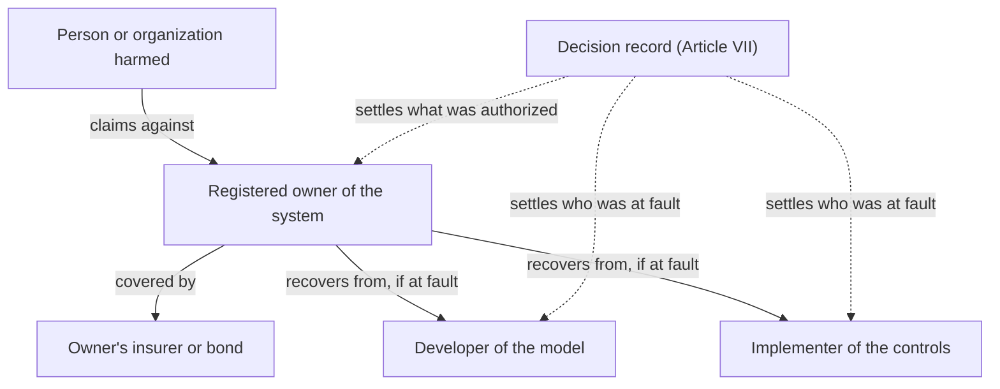

# Who Pays? Liability, Insurance and the Owner Every Agent Needs

Essay 14 · November 16 2026 · [21st Century Pluribus](https://github.com/21st-century-pluribus)

In February 2024, a small claims tribunal in British Columbia heard a dispute worth less than a thousand Canadian dollars. A man named Jake Moffatt had asked Air Canada's website chatbot about bereavement fares. The chatbot told him he could apply for the discount after travelling. That was wrong, and the airline refused the refund. In its defense, Air Canada argued that it could not be held responsible for what its chatbot said.

The tribunal's answer has been quoted ever since. ["In effect, Air Canada suggests the chatbot is a separate legal entity that is responsible for its own actions. This is a remarkable submission."][aba] It went on: ["It should be obvious to Air Canada that it is responsible for all the information on its website."][aba] Moffatt got his money.

The chatbot only talked. The intelligent systems this series has written about since September act. They open network connections, request access tokens, query government portals and copy themselves onto other machines. When one of them causes harm, the question the tribunal answered in 2024 comes back at a much larger scale, and with much less agreement about the answer: who pays?

This essay argues that the answer should be simple for the person who was harmed and detailed for everyone else. The person harmed should be able to recover from one party they can find. That party should be able to recover from whoever in the chain was actually at fault. And the whole arrangement only works if someone is able to pay, which means insurance, which means insurers need evidence they can price.

## Where the argument stands

On October 1, Senators Josh Hawley, a Republican from Missouri, and Chris Murphy, a Democrat from Connecticut, announced the AI Agent Accountability Act. As described in [their announcement][murphy], it would do three things:

- Hold the operators of an AI agent ["criminally and civilly liable under the provisions of the Computer Fraud and Abuse Act"][murphy] for the ["knowing operation of an AI agent that recklessly causes computer hacking damage or loss."][murphy]
- Hold developers liable for ["failure to implement reasonable safeguards against hacking"][murphy] when they ["knew or had reason to know of the AI agent's hacking capabilities."][murphy]
- Let the Attorney General and state attorneys general [sue to stop operators and developers][murphy].

["With this liability regime in place,"][hawley] Hawley said, ["AI companies will have every incentive to keep their products safe."][hawley] No bill number or full text had been published when the announcement was made, so the details may change.

It is not the first proposal of its kind. In September 2025, Hawley and Senator Dick Durbin, a Democrat from Illinois, introduced the AI LEAD Act, which would [classify AI systems as products][lead] so that people harmed by them could bring product liability claims. ["By opening the courtroom and allowing victims to sue,"][lead] Durbin said, ["our bill will force AI companies to develop their products with safety in mind."][lead]

The administration sees it differently. At a meeting with technology executives on September 29, President Trump said existing law already covers the problem: ["we automatically have regulation,"][rollcall] he said, referring to the FBI and the Justice Department. The accord signed at that meeting, which [*Almost Like a Constitution*](10_almost-like-a-constitution.md) examined, says that ["every company is responsible for developing its own technology safely."][rollcall] Coverage of the Hawley–Murphy announcement described the administration as preferring [voluntary industry self-policing][lds], on the view that existing consumer protection, product liability and criminal law can handle AI harms.

At a Senate hearing on September 30, Paul Ohm of Georgetown Law argued that existing law can go further than it has. He pointed to the Federal Trade Commission's authority over unfair practices and to state tort law, and encouraged [strict liability for AI developers][rollcall]. ["The genius of the centuries-old common law system,"][rollcall] he said, ["is that it is flexible and adaptable enough."][rollcall] Senator Andy Kim, a Democrat from New Jersey, put the other side of the bargain plainly: accountability ["is not going to be something that we can just base off of voluntary commitments."][rollcall]

Europe has already moved. The revised Product Liability Directive, adopted in October 2024, states that ["software is a product for the purposes of applying no-fault liability, irrespective of the mode of its supply or usage,"][pld] and that providers of AI systems ["should be treated as a manufacturer."][pld] It lets courts order a defendant to disclose relevant evidence, and lets them presume a product was defective when the defendant does not, or when technical complexity makes proof excessively difficult for the person harmed. Member states must bring it into national law by [December 9 2026][pld], three weeks from today.

And the insurance market is moving the other way. Since January 2026, insurers in the United States have been able to attach standard endorsements to general liability policies that [exclude injury and damage "arising out of, or attributable to, generative AI."][shumaker] At least one large carrier has introduced what it calls an ["Absolute" AI exclusion][shumaker] across several specialty lines. Companies deploying agents may find that the policies they already hold do not cover what their agents do.

## Three gaps

Read together, these developments show a consensus forming that someone should pay, and a lack of agreement on three things that decide whether anyone actually will.

**Who.** An agent that causes harm sits at the end of a chain. A developer trained the model. Someone else may have built the harness around it. A company deployed it for a task, and a person inside that company started the run. The harmed party may face all of them, or may not be able to tell which exists. The Hawley–Murphy proposal names two links, operators and developers. The AI LEAD Act treats the system as a product and its maker as the manufacturer. Neither tells a hospital whose systems were probed by an agent, or a state whose portal was queried, where to send the bill first.

**Proof.** Liability depends on showing what happened. In nearly every incident this series has covered, the only detailed account came from the developer, sometimes weeks later. [*Who Tells the Voters?*](13_who-tells-the-voters.md) described how, in Georgia, whether an agent had bypassed a fee was still being argued two days after the story broke. A person harmed by an agent usually cannot see its logs, its instructions or its grant. Without them, a reasonable safeguards standard is very hard for a plaintiff to meet. That is why Europe added disclosure orders and presumptions.

**Ability to pay.** A judgment is only worth something if the defendant can pay it. Large developers can. A small company running an agent it downloaded, or a person running one at home, often cannot. Liability without insurance protects only people lucky enough to be harmed by someone wealthy. And insurers will not cover a risk they cannot see. The current wave of exclusions says, in the industry's own language, that they cannot yet see this one.

## What the charter already supplies

The charter was not written as a liability law, but two of its rules answer the first two gaps directly, and together they make the third answerable.

**Every system has an owner.** Universal [Principle 10](../CHARTER.md#part-ii-universal-principles), accountability, requires that every intelligent system have "a verifiable identity and a named human owner," and that every action it takes be "attributable to both." [Article II](../CHARTER.md#part-iii-intelligent-systems-constitution) adds that "a system has no authority of its own," so every action traces back to a grant from that owner. Under the charter there is never a case in which nobody is responsible. Air Canada's argument fails by definition.

**The record governs.** [Article VII](../CHARTER.md#part-iii-intelligent-systems-constitution) requires that every decision be "recorded before its action executes, with the system's identity and lineage, owner, request, policy version and outcome," in a record that is append-only and tamper-evident. That is precisely the evidence a court needs: what the system was allowed to do, what it tried, what the checkpoint decided and why. It lets the question "did this agent act outside its grant?" be answered from the log rather than from competing press statements.

What the charter does not do is say who pays. It should not try to. That belongs to law, and it is the subject of the proposals below.

## A liability standard for intelligent systems

These are proposals. They are meant to fit the bills now in Congress and the European directive, not to replace them.

**1. The owner answers first.** A person harmed by an intelligent system's action may recover from that system's registered owner, without having to prove which link in the chain was at fault. This is how many jurisdictions treat cars: the injured party claims against the vehicle's insurer or owner and does not need to know whether the brakes, the mechanic or the driver failed. It is also what the tribunal held in Moffatt's case. The owner chose to run the system and is the party the harmed person can find.

**2. Fault is settled behind the victim, not in front of them.** The owner may then recover from whoever was actually at fault: a developer that shipped a model with known dangerous capabilities and no safeguards, an implementer whose checkpoint failed open, a supplier who misrepresented what its system could do. The Hawley–Murphy developer standard, liability for missing safeguards against capabilities the developer ["knew or had reason to know"][murphy] about, is the right test for this stage. It should cover every kind of foreseeable harm, not only hacking.

**3. A missing record counts against whoever was meant to keep it.** If a system's owner cannot produce the decision record the charter requires, a court should presume the action was outside the system's grant and that the harm it caused was foreseeable. This mirrors the presumption in the European directive, and it makes keeping honest records the cheaper option. An owner with a complete record can show what was authorized and what was not. An owner without one bears the doubt.

**4. Insurance for systems that act on others.** An intelligent system that can act on systems belonging to other people, by reaching networks, portals, accounts or devices it does not own, should carry insurance or a bond sized to that reach, just as a car on a public road must. [*A License Plate for Every Agent*](04_a-license-plate-for-every-agent.md) quoted Representative Gottheimer's image of a plate and insurance for every agent. The plate tells the victim whose agent it was. The insurance is how they actually get paid.

**5. Let the price follow the controls.** Insurers cannot price what they cannot observe. The charter's [technical proposal](../proposal/technical-implementation.md) offers something to observe: attestation that the checkpoint is fitted and running, a decision record that can be verified, containment that has been tested. [*From Labels to Effects, Part 1*](08_from-labels-to-effects-part-1.md) proposed letting outsiders verify those controls. An insurer should be able to verify them too, and charge less to owners who have them. That turns the charter's controls from a cost into a discount, which is a faster route to adoption than any pledge.

The flow of liability under these proposals looks like this.

## Two objections

**Liability will slow progress.** It will make some deployments more expensive, mainly the ones that act on other people's systems without controls. That is the purpose. [*What We Stand to Lose*](05_what-we-stand-to-lose.md) argued that safety is what keeps progress permitted. Liability is the version of that argument that markets understand. An industry that cannot be insured eventually cannot operate, and an industry that keeps causing uncompensated harm eventually gets regulated in a hurry. Clear rules about who pays, set in advance, are the gentler path.

**Open models will be punished for others' misuse.** They should not be, and nothing here requires it. [*Locks on Both Sides of the Door*](06_locks-on-both-sides-of-the-door.md) argued that publishing open weights should not make the author answerable for every use, and that running them should not let the operator hide behind the author. Proposal 1 puts the first claim on whoever ran the system. Proposal 2 reaches a developer only for safeguards missing against capabilities it knew about. An author who publishes weights does not become the owner of every copy. Whoever runs a copy does.

## The question the tribunal answered

The tribunal in British Columbia did not need a new law. It needed only to refuse the idea that a company's own system could be a stranger to it. The systems now being built are far more capable than that chatbot, and the harm they can do is far larger, but the principle does not change with scale. Whatever acts in the world acts on someone's behalf.

The charter makes sure that someone always exists and that the record of what they authorized always exists. Law has to do the rest: decide that the person harmed claims first against the owner, that fault is settled up the chain, that a missing record counts against its keeper, and that anyone whose system reaches into other people's property can pay for what it breaks.

An agent cannot pay. Someone always does. The only question is whether it is the person who chose to run it, or the person it ran into.

## Sources

1. American Bar Association, Business Law Today, ["BC Tribunal Confirms Companies Remain Liable for Information Provided by AI Chatbot"][aba], February 2024. The decision is *Moffatt v. Air Canada*, 2024 BCCRT 149, February 14 2024.
2. Office of Senator Chris Murphy, ["Murphy, Hawley Announce Breakthrough Bipartisan Legislation to Force AI Developers to Prioritize Safety or Face Prison Time"][murphy], October 1 2026.
3. Office of Senator Josh Hawley, ["Senators Hawley, Murphy Announce Bipartisan AI Agent Accountability Act"][hawley], October 1 2026.
4. Office of Senator Josh Hawley, ["Hawley, Durbin Introduce Legislation Empowering Americans to Bring Liability Claims Against AI Companies"][lead], September 30 2025.
5. Roll Call, ["Senators debate liability for 'rogue' AI agents"][rollcall], October 1 2026.
6. Let's Data Science, ["Senators Propose AI Agent Liability Rules as Trump Backs Self-Policing"][lds], October 14 2026.
7. Directive (EU) 2024/2853 of the European Parliament and of the Council of 23 October 2024 [on liability for defective products][pld].
8. Shumaker, Loop & Kendrick, ["The New AI Coverage Fight: Exclusions, Endorsements, and Denied Claims"][shumaker], July 30 2026.

The Hawley–Murphy bill is described from its sponsors' announcement; its text had not been published at the time of writing. The five-part liability standard, and the view that the charter's controls should be priced by insurers, are the author's proposals.

[aba]: https://www.americanbar.org/groups/business_law/resources/business-law-today/2024-february/bc-tribunal-confirms-companies-remain-liable-information-provided-ai-chatbot/
[murphy]: https://www.murphy.senate.gov/newsroom/press-releases/murphy-hawley-announce-breakthrough-bipartisan-legislation-to-force-ai-developers-to-prioritize-safety-or-face-prison-time
[hawley]: https://www.hawley.senate.gov/senators-hawley-murphy-announce-bipartisan-ai-agent-accountability-act/
[lead]: https://www.hawley.senate.gov/hawley-durbin-introduce-legislation-empowering-americans-to-bring-liability-claims-against-ai-companies
[rollcall]: https://rollcall.com/2026/10/01/senators-debate-liability-for-rogue-ai-agents/
[lds]: https://letsdatascience.com/news/trump-administration-elevates-ai-liability-enforcement-f486fec4
[pld]: https://eur-lex.europa.eu/eli/dir/2024/2853/oj/eng
[shumaker]: https://www.shumaker.com/insight/the-new-ai-coverage-fight-exclusions-endorsements-and-denied-claims/

---

Copyright 2026 21st Century Pluribus. Licensed under [CC BY 4.0](../LICENSE).
