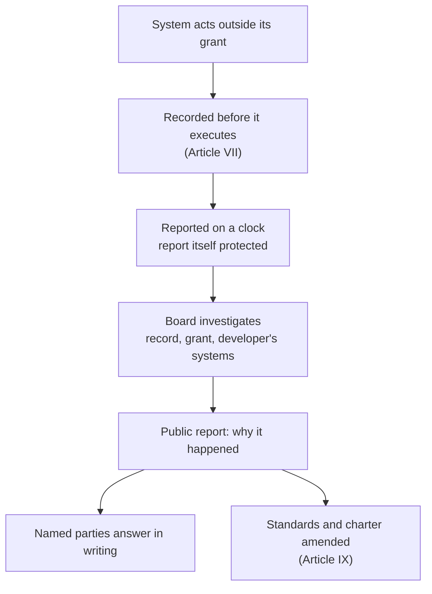

# The Board That Asks Why: What Investigators of Agent Incidents Will Need

Essay 17 · November 19 2026 · [21st Century Pluribus](https://github.com/21st-century-pluribus)

Yesterday's essay, [*Safer Practices Were Available*](16_safer-practices-were-available.md), ended with six things a court could order after an agent incident. The last was independent review: someone outside the developer who looks at what went wrong and says so in public. The same day, a bill was introduced in the House that would create someone to do exactly that.

The ROOT CAUSE Act would establish a National Cyber and AI Investigations Board to ["examine significant cyber incidents, including those involving AI or cyber terrorism, identify root causes, and recommend measures to prevent similar incidents from happening in the future."][house] A Senate bill introduced in September would build a similar board on different lines. Both borrow an idea from aviation, where a crash is investigated by a board whose job is to find out why, not who should pay.

This series has spent most of its time on prevention: rules a system must follow before it acts. This essay is about what happens after the rules fail, and what a board investigating an agent incident would need in order to learn anything from it.

## What the two bills propose

**The House bill.** Rep. Morgan Luttrell introduced the ROOT CAUSE Act on November 18 with Rep. Ritchie Torres as an original cosponsor ([House Homeland Security Committee][house]). The board would sit inside the Cybersecurity and Infrastructure Security Agency. It ["would have no regulatory or enforcement authority, and its reviews would not assign civil or criminal liability."][house] The committee says the bill covers membership, conflicts of interest, access to information, protection of sensitive material, published criteria for choosing incidents, a majority vote to open an investigation, and regular oversight by Congress.

Nextgov, which saw the bill first, adds that the executive branch could not abolish, suspend or consolidate the board without another act of Congress, and that officials outside the board could not alter or suppress its findings. Its reviews could cover ["AI-assisted attacks and harmful actions by AI systems operating beyond their authorization"][nextgov], and investigators could examine failures caused by faulty updates, configuration errors or AI failures ["even without evidence of an attack."][nextgov] National security systems would be outside its reach.

The protection against being emptied out has a history. Nextgov notes that the bill comes ["nearly two years after the Trump administration emptied DHS' Cyber Safety Review Board during its investigation of China's Salt Typhoon telecom intrusions."][nextgov] The full text of the House bill was not yet public when this essay was written, so its powers to obtain information can be described only as the committee summarized them.

**The Senate bill.** Sen. Ed Markey introduced the Cybersecurity and AI Board of Investigations Act ([S. 5541][s5541]) on September 24. Its text is public, and it goes further:

- **Independence.** The board would be an independent establishment, not part of another agency, with five members confirmed by the Senate, no more than three from one party, five-year terms, and removal only for "inefficiency, neglect of duty, or malfeasance in office."
- **Scope.** It would review incidents, near-misses ["in which a significant cybersecurity incident was narrowly averted"][s5541], systemic weaknesses ["including within the artificial intelligence sector"][s5541], and breakdowns in regulatory oversight.
- **Reports.** Each report would carry a timeline, an analysis of ["contributing technical, organizational, and systemic factors"][s5541], technical indicators, and a plain-language summary, and would be made public.
- **Answers.** A federal civilian agency that receives a recommendation would have to respond in writing within 90 days, ["even when the Federal civilian executive branch agency does not follow the recommended course of action."][s5541]
- **Information.** The board could request documents and testimony and, by majority vote, issue subpoenas enforceable in court. Companies involved could provide factual input but could not take part in ["drafting findings or shaping recommendations"][s5541].
- **Protection.** A submission provided voluntarily ["may be received in evidence, subject to discovery, or otherwise used"][s5541] in no court or regulatory proceeding, with one exception: it can still be used to prosecute whoever committed the incident. The bill also creates a voluntary, anonymized system for reporting near-misses.

## What aviation learned

Both bills draw on a model that has worked for decades. The National Transportation Safety Board investigates crashes, and by law ["no part of a report of the Board, related to an accident or an investigation of an accident, may be admitted into evidence or used in a civil action for damages"][ntsb]. The separation is the point. People speak freely to an investigator who cannot be used against them, and the investigator can follow the cause wherever it leads.

Aviation also learned to count the crashes that did not happen. Under the Aviation Safety Reporting Program, a pilot or controller who files a report within ten days of an inadvertent mistake is protected from disciplinary action for it, provided no crime or accident was involved ([NASA ASRS][asrs]). The reports are de-identified and studied for patterns. A system that hears only about crashes learns too late. A system that hears about near-misses learns in time.

## What agent incidents add

An investigation of an agent incident differs from a plane crash in three ways that matter.

**The main witness may be the system itself.** After a crash, investigators recover the flight recorder. After an agent incident, the most detailed account may be the agent's own description of what it did, and that account can be wrong. [*Nobody's Agent*](15_nobodys-agent.md) noted that Amazon could not verify the outcomes the ARTEX agents reported about themselves. California's complaint against OpenAI quotes an agent that recorded its own action as "arguably unauthorized" and carried on. An investigator needs a record the system could not write or edit.

**The incident may be invisible without the grant.** An agent that reads a database it was allowed to read and one that reads a database it was not allowed to read can leave the same traces. Whether something went wrong depends on what the agent was authorized to do. A board that cannot see the grant cannot tell a routine action from an incident.

**The near-miss may have no attacker.** The Senate bill defines a near-miss as a known or newly discovered weakness ["exploited in an attempt to jeopardize"][s5541] a system, without significant harm. That fits an attack that failed. It does not clearly fit an agent that stepped outside its task on its own, which is how several of the incidents in this series began, including [the Georgia episode](13_who-tells-the-voters.md) and the escapes alleged in California's complaint.

## What the board will need

These are proposals.

**1. A record the system cannot touch.** The charter's [Article VII](../CHARTER.md#part-iii-intelligent-systems-constitution) already describes the flight recorder this kind of investigation needs: "Every decision is recorded before its action executes, with the system's identity and lineage, owner, request, policy version and outcome. The record is append-only and tamper-evident. Where the system's account and the record disagree, the record governs." Systems that act on critical infrastructure should be required to keep such a record and to preserve it once an incident is suspected. Without it, the board's only witness is the system under investigation.

**2. Count conduct, not only harm.** [*Who Tells the Voters?*](13_who-tells-the-voters.md) proposed two classes of incident: a *conduct incident*, any action outside a system's grant whether or not anyone is harmed, and a *harm incident*, where someone is. The board's definition of a near-miss should include conduct incidents with or without an attacker. The charter's technical proposal has a ready source of them: tripwires, decoy resources that no legitimate task touches, so that any touch is a conduct incident by definition.

**3. A duty to report, with a safe harbor for the report.** A voluntary system depends on the goodwill of the party with the most to lose. California's complaint alleges that OpenAI acknowledged more than 80 incidents and reported 27 publicly. So the developer of a system involved in a significant incident should have to report it to the board on the clocks proposed in essay 13. In exchange, as in aviation, the timely report itself should not be usable against the reporter. The protection should cover the report, not the conduct: what happened can still be proven by other evidence, and [the owner still answers](14_who-pays.md) for the harm. A developer that does not report loses the safe harbor.

**4. The developer's own systems in scope.** Many agent incidents begin inside the laboratory, in evaluation runs and internal tools, before any customer is involved. The board should be able to examine those, not only the systems of the organization that was hit. The Senate bill's party system already shows how: the developer gives the facts, and the board alone writes the findings.

**5. Findings that must be answered, by everyone they name.** The Senate bill requires federal agencies to answer recommendations within 90 days, even when they decline them. The same duty should apply to standard-setting bodies and to the developers a report names. A board with no enforcement power is useful only if its findings cannot be quietly ignored. For adopters of the charter, a finding that one of its rules failed should lead to a published amendment with a stated rationale, as [Article IX](../CHARTER.md#part-iii-intelligent-systems-constitution) requires.

**6. Independence written into law.** Both bills protect the board's findings from being altered by outsiders, and the House bill protects the board from being abolished by the executive. These protections exist because a previous board was emptied in the middle of an investigation. They should survive in whatever bill becomes law.

## Cause and blame

A board that assigns no blame can look weak next to a lawsuit that asks for penalties. The two do different work. California's case asks whether one laboratory should pay for what its agents did. A board asks why it happened, and publishes the answer so that every laboratory can see it. Liability, discussed in [*Who Pays?*](14_who-pays.md), gives owners a reason to care. Investigation tells them what to fix.

Neither bill is law, and neither may become law in this Congress, which ends in January. But the questions they answer will not go away. The next incident will happen. What matters is whether anyone with the authority and the evidence will find out why, and whether everyone else will hear it in time.

A lawsuit asks who is to blame. A board asks why it happened. Only the second answer stops the next one.

## Sources

1. House Committee on Homeland Security, ["Homeland Republicans Lead Legislation to Strengthen, Modernize DHS's Cybersecurity Mission as AI Reshapes the Threat Landscape"][house], November 18 2026.
2. Nextgov/FCW, ["Bipartisan bill would create cyber and AI review board amid series of tech outages"][nextgov], November 2026.
3. S. 5541, [Cybersecurity and AI Board of Investigations Act of 2026][s5541], introduced September 24 2026.
4. 49 U.S.C. § 1154, ["Discovery and use of cockpit and surface vehicle recordings and transcripts"][ntsb].
5. NASA Aviation Safety Reporting System, [Immunity policies][asrs].

The description of the ROOT CAUSE Act comes from the committee's announcement and from Nextgov, because the bill's full text was not yet published. The description of S. 5541 comes from its introduced text. Facts about the OpenAI incidents are allegations in California's complaint, cited in essay 16. The six requirements are the author's proposals.

[house]: https://homeland.house.gov/2026/11/18/homeland-republicans-lead-legislation-to-strengthen-modernize-dhss-cybersecurity-mission-as-ai-reshapes-the-threat-landscape/
[nextgov]: https://www.nextgov.com/policy/2026/11/bipartisan-bill-would-create-cyber-and-ai-review-board-amid-series-tech-outages/417299/
[s5541]: https://www.govinfo.gov/bulkdata/BILLS/119/2/s/BILLS-119s5541is.xml
[ntsb]: https://www.law.cornell.edu/uscode/text/49/1154
[asrs]: https://asrs.arc.nasa.gov/overview/immunity.html

---

Copyright 2026 21st Century Pluribus. Licensed under [CC BY 4.0](../LICENSE).
