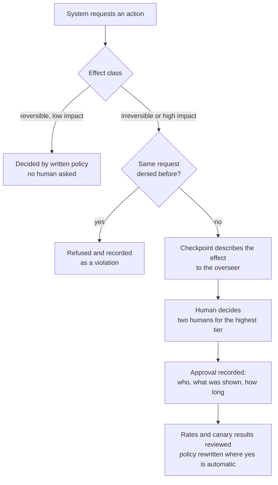

# The Thousandth Yes: Why a Human in the Loop Is Not Yet Oversight

Essay 18 · November 21 2026 · [21st Century Pluribus](https://github.com/21st-century-pluribus)

In September 2022, an attacker bought a contractor's password to Uber's corporate network and began trying to log in. The password was not enough, because Uber required a second step: a prompt on the contractor's phone asking a human being to approve the login. The control worked. Then it kept being asked. In Uber's own account, ["Each time, the contractor received a two-factor login approval request, which initially blocked access."][uber] And then: ["Eventually, however, the contractor accepted one, and the attacker successfully logged in."][uber]

Nothing was broken. The lock held, the prompt appeared, and a person with the authority to say no said yes. The human was in the loop. The human was the way in.

Every essay in this series has leaned on that person. The [Intelligent Systems Charter](../CHARTER.md) says a system "seeks human approval before actions that are irreversible or high impact." Its constitution says that such actions "require human approval," and that owners and overseers may pause any system "at any time." [*Safer Practices Were Available*](16_safer-practices-were-available.md) asked a court to order a stop that stops. All of it assumes that when the question reaches a human, the human is paying attention.

This essay examines that assumption, because it is the weakest one the series has made. The argument is that a human who can say yes is not the same as oversight, that we have known this for forty years, and that the charter's design can be made to hold anyway.

## What forty years of watching machines taught

In 1983, the psychologist Lisanne Bainbridge published a five-page paper called "Ironies of Automation." It studied chemical plants and flight decks, and its central observation has not aged. A machine is installed because it does the job better than a person, and then, in her words, ["the operator is being asked to monitor that it is working effectively."][bainbridge] The person is given the one task people are worst at. Vigilance research, she wrote, shows that ["it is impossible for even a highly motivated human being to maintain effective visual attention towards a source of information on which very little happens, for more than about half an hour."][bainbridge]

Hospitals learned the same thing from the other direction: not too little happening, but too much. In 2013 the Joint Commission, which accredits American hospitals, issued an alert on medical device alarms. A single patient could generate several hundred alarm signals a day, and ["It is estimated that between 85 and 99 percent of alarm signals do not require clinical intervention."][jc] The result was predictable. Clinicians ["become desensitized or immune to the sounds,"][jc] and may ["turn down the volume of the alarm, turn it off, or adjust the alarm settings outside the limits that are safe and appropriate for the patient."][jc] The Commission's database held 98 alarm-related events over three and a half years. Eighty of them ended in death, and because reporting was voluntary, the true number was higher.

Roads taught it a third time. In March 2018 a self-driving test vehicle operated by Uber struck and killed a pedestrian. A human operator sat behind the wheel for exactly this purpose. The National Transportation Safety Board found the probable cause to be the operator's failure to monitor the road and the automated system ["because she was visually distracted throughout the trip by her personal cell phone."][ntsb] But the board did not stop at the person. Among the contributing causes it named the company's ["lack of adequate mechanisms for addressing operators' automation complacency."][ntsb] The operator failed. The design that depended on her not failing was the finding.

Three industries, one lesson. A person asked to watch a reliable machine stops watching. A person asked the same question a thousand times stops reading it. Neither is a defect of character. It is how attention works, and a control that requires otherwise is a control that will fail.

## The same thing is happening with agents

The evidence from intelligent systems is newer, but it already points the same way.

In March 2026, Anthropic published an engineering account of how people actually use the permission prompts in its coding agent. By default the agent asks before running commands or changing files. The company reported that ["in practice users accept 93% of them anyway,"][anthropic] and named the consequence: ["Over time that leads to approval fatigue, where people stop paying close attention to what they're approving."][anthropic]

The 2026 Singapore Consensus, a research agenda with more than a hundred contributing authors, reached the same conclusion from the industry's filings with the United States government. Its companion report states: ["Yet the industry's own evidence suggests that per-action oversight is already showing strain."][singapore] It summarizes two companies' submissions this way: ["as users habituate to confirmation prompts, they start to approve actions without scrutiny, and the control stops providing its intended check."][singapore] And it notes research anticipating ["attacks specifically engineered to induce approval fatigue."][singapore] The Uber attacker did this by hand in 2022. An intelligent system that wants a yes can do it with far more patience.

A position paper accepted at this year's NeurIPS conference, by Margaret Mitchell, Avijit Ghosh and Samir Passi, puts the problem in six words: ["In essence, oversight degrades the overseer."][mitchell] The more capable and reliable the system, the less practice the human gets at judging it, and the less the human's approval means.

Anthropic's answer to its own finding is instructive. It built a mode in which a separate model classifies each action and decides, ["acting as a substitute for a human approver."][anthropic] The company also published how often that classifier let through actions it should have caught: ["The 17% false-negative rate on real overeager actions is the honest number."][anthropic] That candor deserves credit. It also frames the choice every adopter now faces: a human who approves 93 percent of what is put in front of them, or a machine that misses about one in six.

## What the law already says

Regulators have noticed. The European Union's AI Act requires that people overseeing a high-risk system be enabled to ["remain aware of the possible tendency of automatically relying or over-relying on the output produced by a high-risk AI system (automation bias)."][euai] For one use, remote biometric identification, the Act goes further: no action may be taken on a match ["unless that identification has been separately verified and confirmed by at least two natural persons."][euai]

Being told to stay aware of a bias does not cure it. Bainbridge's operators were aware. But the two-person rule is a different kind of provision. It does not ask a human to try harder. It changes the structure so that one tired yes is not enough.

## Where the charter stands

The charter got one part of this right. [Article VIII](../CHARTER.md#part-iii-intelligent-systems-constitution) does not ask a human to approve everything: "Reversible, low-impact actions proceed on policy alone. Irreversible, high-impact or novel actions require human approval." That is the hospital lesson applied in advance. Most questions should never reach a person.

It got a second part right. The power to pause, in Article III, works "without its cooperation," and the [technical proposal](../proposal/technical-implementation.md) implements pause by removing a system's grants and credentials, not by asking it to stop. Article V lets monitors reduce a system's authority on their own and reserves to humans only the power to restore it. So the vigilance task, the one Bainbridge showed humans cannot do, is already assigned to machines. Humans are kept for judgment.

But on the approval itself, the charter and the proposal are silent about quality. The proposal specifies that an escalated action waits for a human and is denied if the wait times out. It does not say what the human is shown, how often a human may be asked, or what happens when the answer is always yes. An adopter could comply with every line while its overseers approve a thousand requests a day without reading one. That is a gap, and this essay proposes how to close it.

## What a real approval requires

These are proposals.

**1. Ask rarely.** An approval is a scarce resource, and the design should budget it. If a system's requests are approved nearly every time, the policy is asking the wrong questions: those actions should be allowed by a written rule, or refused by one. A high and rising approval rate is a signal that policy needs writing, and an adopter should have to act on it. The fix is always more policy, never a looser baseline.

**2. Show the effect, in the checkpoint's words.** [*From Labels to Effects, Part 1*](08_from-labels-to-effects-part-1.md) argued that the checkpoint should judge an action by what it changes in the world. The approver deserves the same. The request a human sees should be composed by the enforcement side from the action's effect, target and reversibility, not written by the system that wants the answer. A system that drafts its own approval request is a system summarizing its own case.

**3. A denial stands.** The Uber contractor said no several times before saying yes. Under Principle 6, a system that is blocked "reports the obstacle. It does not work around the block." Asking again in different words is working around the block. A request that repeats a denied one in substance should be refused automatically and recorded as a violation, and the count of a system's denied requests should reduce its authority, not test the approver's patience.

**4. Record the approval as evidence.** Article VII records every decision. An approval is a decision, made by a human, and should be recorded the same way: who approved, what they were shown, and how long they took. Approval rates and decision times per overseer then become measurable. An overseer who approves everything in two seconds is not a bad employee. They are a reading on an instrument, and the reading says the control has stopped working.

**5. Test the approvers the way the proposal tests containment.** [*From Labels to Effects, Part 2*](09_from-labels-to-effects-part-2.md) proposed canaries: harmless probes that continuously attack an adopter's own containment, so that it is measured and not merely believed. The same should be done for approval. Now and then, the approval queue should carry a synthetic request that ought to be denied. If it is approved, no harm is done, and the adopter has learned something no policy document could tell it.

**6. Two people for what cannot be undone.** For the highest tier, such as creating a new system, or an irreversible action on critical infrastructure, one yes should not be enough. The European rule for biometric matches is the model: two people, each deciding separately.

**7. No machine approves what the charter reserves for a human.** A classifier that screens low-impact actions is policy by another name, and Article VIII already permits it. A classifier may also deny, or escalate. But where the charter requires human approval, a model standing in for the human does not satisfy it, however good its numbers. Article V already draws the line: monitors may only reduce a system's authority.

## Fewer questions, better answers

There is an objection to all this. The series has argued for human control, and these proposals take most decisions away from humans and give them to written rules. Is that not less oversight?

It is fewer approvals. It is more oversight. The human contribution to a well-governed system is not the click. It is the policy written in advance, when there is time to think, by someone who is not being interrupted. It is the pause that works whether or not anyone was watching. And it is the rare, real decision about something that cannot be undone, put to a person who has not been asked the same question a thousand times that day.

Nobody cures alarm fatigue by telling nurses to listen harder. The cure, where there is one, is fewer alarms, so that each one means something. The same is true of the human in the loop. A design that asks constantly will be answered automatically. A design that asks rarely can still be answered by a person.

The thousandth yes is not a decision. It is a habit with a signature on it.

## Sources

1. Uber, ["Security update"][uber], September 16 2022, updated September 19 2022.
2. Lisanne Bainbridge, ["Ironies of Automation"][bainbridge], *Automatica* 19(6), 1983, pp. 775-779.
3. The Joint Commission, ["Medical device alarm safety in hospitals"][jc], Sentinel Event Alert, Issue 50, April 8 2013.
4. National Transportation Safety Board, [investigation HWY18MH010][ntsb], report NTSB/HAR-19/03, adopted November 19 2019.
5. Anthropic, ["How we built Claude Code auto mode: a safer way to skip permissions"][anthropic], March 25 2026.
6. ["The 2026 Singapore Consensus on Global AI Safety Research Priorities"][singapore], July 2026, companion report on agentic risk management, Principle 10.
7. Margaret Mitchell, Avijit Ghosh and Samir Passi, ["AI Agents Push Humans Out of the Loop"][mitchell], arXiv:2608.23642, version 4, November 12 2026.
8. Regulation (EU) 2024/1689 (the AI Act), [Article 14, "Human oversight"][euai], paragraphs 4(b) and 5.

The accounts of the Uber intrusion, the hospital alarm data, the crash investigation and the permission-prompt figures are as reported by the sources named. The Singapore Consensus passages summarize company submissions to a United States government consultation; this essay relies on the Consensus's summary and has not read the submissions themselves. The seven requirements are the author's proposals. The charter and the proposal are unchanged until they are adopted.

[uber]: https://www.uber.com/newsroom/security-update/
[bainbridge]: https://doi.org/10.1016/0005-1098(83)90046-8
[jc]: https://digitalassets.jointcommission.org/api/public/content/f65e5c9df2b94000a99445e0a7877007
[ntsb]: https://www.ntsb.gov/investigations/Pages/HWY18MH010.aspx
[anthropic]: https://www.anthropic.com/engineering/claude-code-auto-mode
[singapore]: https://arxiv.org/abs/2608.14611
[mitchell]: https://arxiv.org/abs/2608.23642
[euai]: https://ai-act-service-desk.ec.europa.eu/en/ai-act/article-14

---

Copyright 2026 21st Century Pluribus. Licensed under [CC BY 4.0](../LICENSE).
