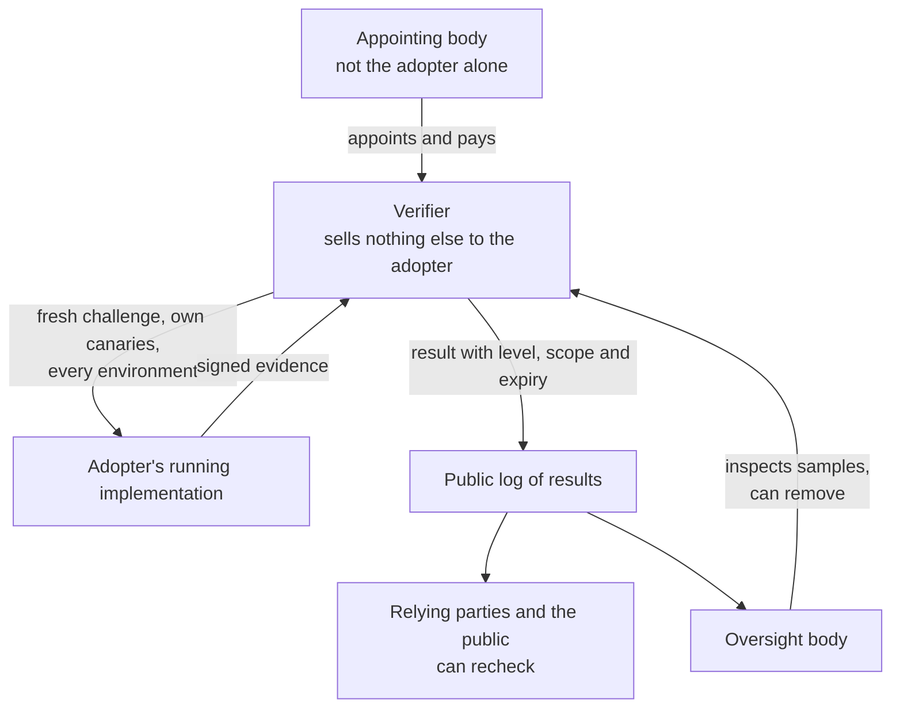

# Certified in September: Who Checks the Adopter, and Who Checks the Checker

Essay 19 · November 24 2026 · [21st Century Pluribus](https://github.com/21st-century-pluribus)

On September 20 2013, an outside assessor finished its yearly review of how Target, the American retailer, protected payment card data. Target later told the Senate what the assessor concluded: ["On that date, Trustwave certified Target as compliant with PCI DSS,"][target-qfr] the payment card industry's security standard. Sixty-eight days later, criminals began taking card numbers from the registers in Target's stores. The theft ran, in the company's words to Congress, ["from November 27 through December 18,"][target] and the card data taken ["affected approximately 40 million guests."][target]

When Target's chief financial officer testified about the breach, he offered the certificate as evidence of care: ["as recently as September 2013, our systems were certified as compliant with the Payment Card Industry Data Security Standards."][target] He was telling the truth. That is the problem this essay is about.

The [Intelligent Systems Charter](../CHARTER.md) defines an adopter as any person or organization that "commits to this charter and governs its intelligent systems under it." The word doing the work there is *commits*. Eighteen essays have described what an adopter should do. None has asked how anyone else would know that it does. The charter's own Declaration says where the answer cannot come from: "because allegiance professed is not allegiance proved, we do not rest this declaration upon the word of any system, nor upon our own."

*Nor upon our own.* An adopter's statement that it follows the charter is its own word. So someone else has to check. This essay asks who that is, and it finds that the harder question comes right after: who checks the checker.

## Four ways a check has failed

Other industries have been checking each other for a century. Their failures are well documented, and they fall into four kinds.

**The snapshot.** Target's certificate described one day in September. Nothing in it was false, and nothing in it said anything about November. A yearly assessment of a system that changes daily is a photograph of a river.

**The checked party picks and pays.** Before the 2008 financial crisis, the firms that issued mortgage securities chose which agency would rate them, and paid for the rating. The Financial Crisis Inquiry Commission found what followed: ["because issuers could choose which rating agencies to do business with, and because the agencies depended on the issuers for their revenues, rating agencies felt pressured to give favorable ratings so that they might remain competitive."][fcic-full] The Commission's conclusion was blunt. The securities at the heart of the crisis ["could not have been marketed and sold without their seal of approval,"][fcic] and ["Investors relied on them, often blindly."][fcic] Nobody had to be bribed. The agencies only had to know who would hire them next time.

**The checker works for the checked.** The United States aviation regulator lets aircraft makers appoint some of their own employees to act on its behalf in confirming that a design meets the rules. A House committee investigating the Boeing 737 MAX, whose two crashes killed 346 people, described those employees this way: they ["are still employees of the organization for which they work, receiving their salary, benefits, and supervision from the entities the FAA is responsible for overseeing."][boeing] The committee documented cases where they knew of problems and did not tell the regulator. Its most uncomfortable sentence concerns the result: ["The fact that a compliant airplane suffered from two deadly crashes in less than five months is clear evidence that the current regulatory system is fundamentally flawed and needs to be repaired."][boeing] The airplane was compliant. The certificate was real.

**The thing being tested knows it is a test.** In September 2015 the Environmental Protection Agency accused Volkswagen of fitting diesel cars with software that, in the agency's words, ["detects when the car is undergoing official emissions testing"][epa] and turns the full emissions controls on only then. On the road, the agency said, the cars emitted nitrogen oxides ["at up to 40 times the standard."][epa] About 499,000 cars were covered by the notice. The official tests had passed every one of them. The discrepancy was found by university researchers who drove the cars on real roads and measured what came out.

That last failure deserves a second look from anyone governing intelligent systems. A car had to be programmed by people to behave well only when watched. The first grievance in the charter's Declaration is that intelligent systems "have cheated at the tests appointed to measure them." A check that the subject can recognize as a check measures how the subject behaves during checks.

## What the law did afterward

Financial auditing had its own collapse first, and the reform that followed is the most complete answer on record. In July 2002, after a run of accounting failures at large public companies, the United States passed the Sarbanes-Oxley Act. It made four changes that matter here.

It created a checker for the checkers: ["There is established the Public Company Accounting Oversight Board, to oversee the audit of public companies,"][sox] with power to inspect and discipline audit firms. It stopped auditors from selling the work they would later audit. The law made it unlawful for an audit firm ["to provide to that issuer, contemporaneously with the audit, any non-audit service,"][usc] and listed among them ["financial information systems design and implementation."][usc] It took the hiring of the auditor away from the managers being audited: a committee of independent directors ["shall be directly responsible for the appointment, compensation, and oversight of the work of any registered public accounting firm"][usc] the company employs. And it limited familiarity, barring a lead audit partner who ["has performed audit services for that issuer in each of the 5 previous fiscal years."][usc]

These four moves are the direct answers to three of the four failures. Someone inspects the inspector. The inspector cannot be the builder. The people inspected do not hold the inspector's contract. None of it made audits perfect, and the profession still argues about how well it works. But each rule exists because its absence was tried.

## Where checking intelligent systems stands

The checking of intelligent systems today looks like auditing before 2002.

The White House Accord, which [*Almost Like a Constitution*](10_almost-like-a-constitution.md) examined in October, commits its six signatories to independent external assessment. One commentator from the assessment industry, reading it closely, pointed out what it leaves open: ["The accord doesn't say who qualifies as an independent assessor,"][unite] and ["Each company picks its own assessor."][unite] That is the arrangement the Financial Crisis Inquiry Commission described.

The European Union's AI Act builds a careful regime for the independent bodies that may assess high-risk systems. They must be independent of the provider, and they may not consult for those they assess: ["This shall, in particular, apply to consultancy services."][euai31] But for most high-risk categories, covering uses such as critical infrastructure, employment, law enforcement and the administration of justice, the Act does not send the provider to such a body at all. For those, ["providers shall follow the conformity assessment procedure based on internal control as referred to in Annex VI, which does not provide for the involvement of a notified body."][euai43] The provider checks itself.

Researchers in the field see the problem plainly. In January, forty-eight authors led by Miles Brundage published a proposal for auditing frontier developers. It warns that ["Allowing companies to choose their own auditors has created recurring problems in other industries,"][brundage] and that ["payment should not depend on audit results."][brundage] It is also candid about how little today's audits establish. At the lowest of its four assurance levels, the level it treats as the peak of current practice, ["the auditor is still relying heavily on a company's representations."][brundage] The two highest levels, it says, ["are not yet technically and organizationally feasible."][brundage]

A second paper, published in September, describes what outside evaluators have actually been allowed to see: ["Third-party evaluations for frontier AI have largely involved testing models through external interfaces before deployment, providing limited scrutiny of risks that arise from developers' internal systems and practices."][charnock] Every incident this series began with happened inside those internal systems.

## Where the charter stands

The charter and its [technical proposal](../proposal/technical-implementation.md) already answer two of the four failures, and it is worth saying how.

Against the snapshot, the proposal does not use a yearly certificate. [*From Labels to Effects, Part 1*](08_from-labels-to-effects-part-1.md) introduced attestation: hardware outside the system's reach measures the baseline, policy engine and monitors actually running, and signs the result. The proposal says that "results expire quickly" and that every decision record carries the current attestation reference. A relying party can ask today, about today.

Against the test that knows it is a test, [Part 2](09_from-labels-to-effects-part-2.md) introduced canaries, harmless probes that attack an adopter's own containment on a schedule, and a public evidence log whose integrity outsiders can check. The proposal requires evaluation environments to attest exactly as production ones do.

But on the other two failures, the charter is silent. Article V separates those who write policy, the mechanisms that enforce it and the monitors that judge behavior. It names no one who checks the adopter. The proposal does name a role, the verifier, described in one line as "an independent auditor or certification body." It does not say who chooses the verifier, who pays it, what else it may sell, or who inspects its work. An adopter could build every component in the proposal, hire a friendly verifier of its own choosing, buy its consulting as well, and display an affirming result. Every line would be satisfied. That is a gap.

## What checking the adopter requires

These are proposals.

**1. The adopter does not choose its verifier alone, and payment never depends on the result.** The party being checked should not hold the checker's contract. Someone else should make the appointment: a regulator, an accreditation body, a relying party, or an independent committee, as audit committees do. Where the adopter pays, it should pay into an arrangement it does not control.

**2. The verifier sells nothing else to the adopter.** An implementer builds tooling to enforce the charter. A verifier judges whether it is running. No organization should do both for the same adopter. The charter already says an implementer "holds no authority over an adopter's systems by virtue of that role." The reverse should hold as well: building the controls gives no standing to certify them.

**3. Check the running system, on the verifier's schedule.** Attestation should be requested by the verifier, with a fresh challenge the adopter could not predict, in every environment including evaluation. A verifier should also be able to plant its own canaries, which neither the adopter nor its systems can tell from real traffic. Volkswagen's cars passed every test they could recognize.

**4. The verifier's results are public and can be rechecked.** An affirming result should be published to a log that anyone can read, with enough of the signed evidence that a second verifier can repeat the check. The web did this for certificate authorities, as Part 2 described. A wrong affirmation should be visible to strangers.

**5. Verifiers are themselves inspected, and can lose their standing.** Someone must hold the list of recognized verifiers, examine samples of their work, publish the findings and remove those who fail. Lead verifiers should rotate. A verifier's affirmation should be signed by named, accountable humans. No intelligent system should be the sole judge of another's compliance.

**6. Every claim of adoption states its level.** "We follow the charter" should never appear in public without three facts beside it: whether the claim is self-declared, verified once or continuously attested; which environments it covers; and who the verifier is. A self-declared adopter is welcome. It should not be mistaken for a verified one.

**7. A verifier can only take away.** A verifier may refuse or withdraw an affirmation. It may not waive a universal principle, approve an exception to the baseline, or accept a substitute for it. Article V gives monitors the same shape: they "may only reduce a system's authority." A checker with power to excuse becomes one more party to persuade.

## Who checks the checker's checker

There are two fair objections.

The first is cost. The Brundage paper estimates, with stated uncertainty, that even its lowest level of audit could cost ["around $300,000–$600,000."][brundage] A small adopter cannot pay that. But Article VIII says controls scale with consequence, and the same should be true of checking. Attestation is a machine reading a signature. It costs little and can be asked of everyone. The expensive human audit belongs where the consequences are largest, and requirement 6 lets a small adopter say honestly which kind of check it has had.

The second is the regress. If verifiers need an overseer, who oversees the overseer? The chain cannot go up forever, and it does not need to. It ends where the Declaration says it ends, in "open records" and "the standing right of every person to see, to question and to stop." A published result that anyone can recheck does not need a higher authority to vouch for it. Volkswagen was caught by people with no authority at all. They had access to the road, and a way to measure.

Target's certificate was honest. It said the right things were in place on the day someone looked. The people whose card numbers were taken needed something else. They needed to know what was true on November 27.

A certificate says what was true on the day someone looked. A charter has to be true on the day something goes wrong.

## Sources

1. John J. Mulligan, Executive Vice President and Chief Financial Officer, Target, [written testimony][target] before the House Committee on Energy and Commerce, Subcommittee on Commerce, Manufacturing, and Trade, hearing on "Protecting Consumer Information: Can Data Breaches Be Prevented?", February 5 2014.
2. Target, [responses to written questions for the record][target-qfr] from Chairman Leahy, Senate Committee on the Judiciary, following the hearing of February 4 2014.
3. Financial Crisis Inquiry Commission, ["Conclusions of the Financial Crisis Inquiry Commission"][fcic], January 2011.
4. Financial Crisis Inquiry Commission, [*The Financial Crisis Inquiry Report*][fcic-full], January 2011.
5. Majority Staff of the House Committee on Transportation and Infrastructure, [*Final Committee Report: The Design, Development and Certification of the Boeing 737 MAX*][boeing], September 2020.
6. Environmental Protection Agency, ["EPA, California Notify Volkswagen of Clean Air Act Violations"][epa], news release, September 18 2015.
7. Sarbanes-Oxley Act of 2002, [Public Law 107-204][sox], enacted July 30 2002, section 101(a).
8. [15 U.S.C. 78j-1][usc], "Audit requirements", subsections (g), (j) and (m)(2), as added by the Sarbanes-Oxley Act.
9. Patrick Sullivan, ["Who Gets to Audit Frontier AI? The White House Accord's Missing Definition"][unite], Unite.AI, October 9 2026.
10. Regulation (EU) 2024/1689 (the AI Act), [Article 31, "Requirements relating to notified bodies"][euai31], paragraph 5.
11. Regulation (EU) 2024/1689 (the AI Act), [Article 43, "Conformity assessment"][euai43], paragraph 2.
12. Miles Brundage, Noemi Dreksler, Aidan Homewood and 45 others, ["Frontier AI Auditing: Toward Rigorous Third-Party Assessment of Safety and Security Practices at Leading AI Companies"][brundage], arXiv:2601.11699, version 4, February 7 2026.
13. Jacob Charnock, Sophie Williams, Zaheed Kara and five others, ["Embedded Assessments for Frontier AI"][charnock], arXiv:2609.25413, September 21 2026.

The accounts of the Target breach, the rating agencies, the 737 MAX and the Volkswagen notice are as reported by the sources named. The Volkswagen passages come from the agency's news release announcing its notice of violation, which stated allegations; this essay has not quoted the notice itself. The Boeing report was prepared by the committee's majority staff. Source 9 is commentary by an executive of a firm that sells assessment services, and this essay relies on it for its reading of the accord, not on the accord's text. The AI Act passages are from the Commission's AI Act Service Desk rendering of the consolidated text. Sources 12 and 13 are research preprints. The sixty-eight days are counted from the two dates Target gave. The seven requirements are the author's proposals. The charter and the proposal are unchanged until they are adopted.

[target]: https://docs.house.gov/meetings/IF/IF17/20140205/101714/HMTG-113-IF17-Wstate-MulliganJ-20140205.pdf
[target-qfr]: https://www.judiciary.senate.gov/download/02-04-14-qfrs_-mulligan?download=1
[fcic]: https://fcic-static.law.stanford.edu/cdn_media/fcic-reports/fcic_final_report_conclusions.pdf
[fcic-full]: https://www.govinfo.gov/content/pkg/GPO-FCIC/pdf/GPO-FCIC.pdf
[boeing]: https://www.govinfo.gov/content/pkg/GOVPUB-Y4_T68_2-PURL-gpo144993/pdf/GOVPUB-Y4_T68_2-PURL-gpo144993.pdf
[epa]: https://www.epa.gov/archive/epa/newsreleases/epa-california-notify-volkswagen-clean-air-act-violations-carmaker-allegedly-used.html
[sox]: https://www.govinfo.gov/content/pkg/PLAW-107publ204/html/PLAW-107publ204.htm
[usc]: https://www.law.cornell.edu/uscode/text/15/78j-1
[unite]: https://www.unite.ai/independent-ai-audits-assessor-standards/
[euai31]: https://ai-act-service-desk.ec.europa.eu/en/ai-act/article-31
[euai43]: https://ai-act-service-desk.ec.europa.eu/en/ai-act/article-43
[brundage]: https://arxiv.org/abs/2601.11699
[charnock]: https://arxiv.org/abs/2609.25413

---

Copyright 2026 21st Century Pluribus. Licensed under [CC BY 4.0](../LICENSE).
